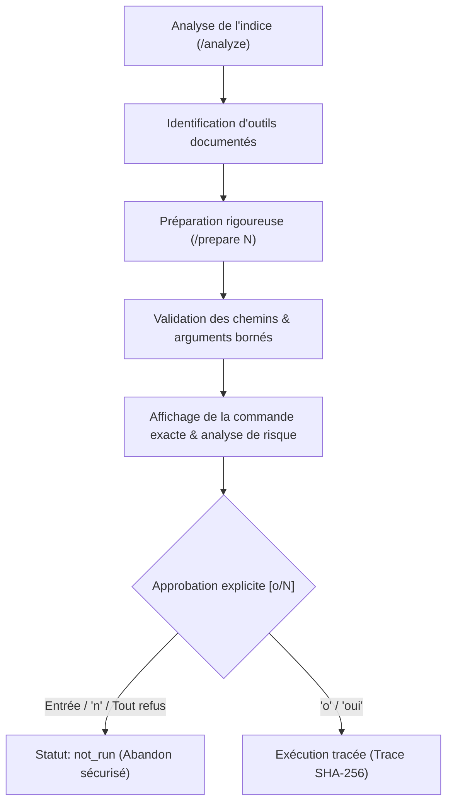

# Architecture et Référence de l'Expérience Utilisateur Terminal (UX REPL) — UCHAMBUZI

> Référence de composant ou recette historique, conservée pour sa provenance. Pour la V1.0.0, utiliser l’[index courant](README.md), les [commandes](commandes.md) et la [note de recette V1](releases/1.0.0.md). Ce document ne certifie pas le candidat actuel.

> Note pour 0.3.0-beta.2 : ce document décrit des composants ou recettes historiques.
> Le REPL courant présente quatre Teams ; seule OSINT est active.
> Les anciens profils restent internes et ne sont plus proposés par `/mode`.
> Voir [les commandes actuelles](commandes.md) et [les fonctionnalités](fonctionnalites.md).


**Version :** 3.0  
**Statut :** Spécification technique et documentation de référence  
**Cible :** Environnement terminal interactif natif (`Rich` + `Prompt_Toolkit`)  
**Compatibilité système :** Kali Linux (VMware / natif), Debian/Ubuntu, sessions SSH distantes  

---

## 1. Philosophie & Grammaire Visuelle

### 1.1 Contexte et Choix Architectural : Le Modèle REPL Moderne

L'investigation numérique, le forensic système et l'analyse de cybermenaces imposent une charge cognitive élevée. L'analyste doit constamment corréler des indicateurs techniques hétérogènes (adresses IP, hash SHA-256, noms de domaine, captures réseau pcap, métadonnées EXIF, dumps mémoires et journaux d'événements) tout en garantissant la rigueur probatoire de sa démarche.

Dans ce contexte opérationnel, les interfaces texte classiques présentent deux écueils majeurs :
1. **L'enfermement dans un plein écran `curses` (altscreen)** : ce paradigme rigide capture le terminal, neutralise l'ascenseur de défilement naturel (scrollback souris), crée des zones mortes lors du redimensionnement sous machine virtuelle (VMware) et interdit le copier-coller fluide entre plusieurs fenêtres ou consoles d'investigation.
2. **La surcharge visuelle des bordures imbriquées** : l'accumulation de cadres, de fenêtres flottantes et de pavés colorés pleins distrait l'analyste, nuit à la lisibilité des commandes complexes et fragmente l'historique chronologique des faits.

UCHAMBUZI adopte la philosophie ergonomique des références modernes du développement et de l'orchestration assistée par IA (**Claude Code**, **Codex CLI**, **Aider**) :
- **Flux terminal continu et natif** : l'application s'exécute directement dans le flux standard du terminal hôte. L'historique du shell en amont est respecté, et le défilement fluide à la molette reste disponible à tout instant sans interception matérielle agressive.
- **Aération visuelle et focalisation cognitive** : suppression du bruit géométrique superflu. Les délimitations horizontales fines séparent clairement les phases d'analyse sans enfermer l'écran dans une grille rigide.
- **Rendu Markdown sémantique en streaming direct** : les réponses du modèle d'IA local (Ollama / `qwen2.5:3b`) sont diffusées en temps réel avec coloration syntaxique ciblée (titres cyan `#38BDF8`, extraits de code inline orange `#E85D26`, blocs de commandes colorés selon le langage, fond terminal natif sans padding résiduel).

```text
  [Flux conversationnel et résultats d'outils antérieurs conservés dans le scrollback]
  ────────────────────────────────────────────────────────────────────────────────
  ⏺ Analyse de l'indice : 198.51.100.24 (IP publique)
    └ whois — Consultation des registres RIR
      ⎿  NetRange: 198.51.100.0/24 | Org: TEST-NET-2 | Pays: US
    └ dig — Résolution DNS inverse (PTR)
      ⎿  100.51.198.in-addr.arpa domain name pointer ns1.example.org.
  
  ⠋ Évaluation forensique en cours · 2 s · Ctrl+C interrompre
  ────────────────────────────────────────────────────────────────────────────────
  › _
  ────────────────────────────────────────────────────────────────────────────────
   ◈ UCHAMBUZI │ Mode: OSINT Team │ IA: qwen2.5:3b │ Dossier: #INC-2026-08 │ /help 
```

---

### 1.2 Grammaire Visuelle et Système de Puces Sémantiques

La restitution des informations suit une convention typographique stricte permettant à l'enquêteur d'identifier d'un simple coup d'œil la nature, le statut et le niveau hiérarchique de chaque élément affiché :

| Symbole | Nom technique | Rôle et sémantique dans l'investigation |
| :---: | :--- | :--- |
| **`⏺`** (ou `●`) | **Puce d'étape validée** | Marque le lancement ou l'achèvement d'une étape technique ou d'un tour d'analyse confirmé. Colorée en vert pour un succès ou une commande validée, cyan pour une gestion de dossier, et orange/secondaire pour les jalons d'orchestration. |
| **`⎿ `** (ou `└ `) | **Sous-détail / Résultat** | Indique une métadonnée forensique rattachée à l'étape parente, une propriété extraite (ex. champ d'en-tête, empreinte SHA-256) ou un résumé compact de sortie d'outil (limité par défaut à 3 lignes). |
| **`› `** (ou `> `) | **Invite utilisateur (Prompt)** | Préfixe interactif de la ligne de saisie de l'analyste, affiché en cyan éclatant (`#38BDF8`), guidant la saisie sans interférer avec les sélections de texte. |
| **`⠋`** | **Indicateur d'activité** | Spinner dynamique en caractères Braille (`⠋⠙⠹⠸⠼⠴⠦⠧⠇⠏` cadencé à 8 images/s par `repl_activity.py`) animé au-dessus de la ligne de commande, combiné à un verbe contextuel (`Rédaction…`, `Analyse forensique…`, `Recherche documentaire…`, `Vérification des outils…`, `Exécution approuvée…`), un compteur de temps écoulé et un rappel d'interruption (`Échap pour interrompre` ou `Ctrl+C`). |
| **`•`** | **Point de sortie compactée** | Introduit le titre d'une commande d'outil exécutée et signale la disponibilité d'une sortie complète via `/details [n°]` ou le raccourci `Ctrl+T`. |

#### Traitement des flux verbeux et sorties d'outils
Afin de préserver la lisibilité de la session, les sorties d'outils système (`tshark`, `exiftool`, `nmap`, `strings`) ne saturent pas l'écran principal :
1. Les **trois premières lignes significatives** sont affichées sous la puce `⎿ `.
2. Une mention explicite `+ N lignes · /details <ID> pour développer` indique le volume résiduel.
3. L'exécution de `/details` ou la frappe de `Ctrl+T` / `Ctrl+O` développe l'intégralité du tampon textuel conservé en mémoire sans jamais réexécuter l'outil sur le système.

---

### 1.3 Conservation de l'Identité Visuelle UCHAMBUZI

Le respect du modèle REPL moderne ne sacrifie en rien la forte identité visuelle d'UCHAMBUZI. L'interface intègre nativement les éléments fondamentaux de la charte graphique :

#### 1. Bannière officielle et Logo Vectoriel ASCII / TrueColor
Au lancement et lors de la commande `/clear`, la console présente le symbole officiel d'UCHAMBUZI fidèlement transposé depuis `uchambuzi-symbol.svg` :
- **Crête supérieure triangulaire** stylisée en orange éclatant (`#E85D26`).
- **Réticule central et viseur forensique** (`╭──┼──╮`, `─┤ ● ├─`, `╰──┼──╯`) symbolisant la précision du ciblage d'indices.
- **Repères latéraux et cercles de visée** (`◀`, `▶`, `●`) évoquant l'orientation et l'investigation périmétrique.
- Restitution en TrueColor 24-bit avec adaptation automatique aux contrastes du terminal hôte.

#### 2. Les 4 Pôles Cyber Opérationnels (`/team` ou `/pole`)
L'orchestration UCHAMBUZI s'articule autour de 4 pôles cyber interconnectés, accessibles par la commande `/team <pôle>` ou la grille visuelle compacte :

```text
  ┌─────────────────────────────────┐   ┌─────────────────────────────────┐
  │ 🔍 1. OSINT Team        [ACTIF] │   │ 🎯 2. Red Team                  │
  │ whois · dig · exiftool · recon  │   │ nmap · nuclei · nikto · testssl │
  └─────────────────────────────────┘   └─────────────────────────────────┘
  ┌─────────────────────────────────┐   ┌─────────────────────────────────┐
  │ 🛡️ 3. Blue Team                 │   │ 🔀 4. Purple Team               │
  │ tshark · zeek · suricata · soc  │   │ MITRE ATT&CK · Atomic · Sigma   │
  └─────────────────────────────────┘   └─────────────────────────────────┘
```

1. **OSINT Team** (`MODE_INTEL` — Cyan `#38BDF8`) : Renseignement sur sources ouvertes, reconnaissance passive, investigation de domaines, registres WHOIS et métadonnées d'images/documents.
2. **Red Team** (`MODE_ASSESS` — Rouge `#EF4444`) : Audit d'exposition, scanning réseau borné, cartographie des vulnérabilités de surface et tests de configuration SSL/TLS.
3. **Blue Team** (`MODE_DEFEND` — Bleu `#3B82F6`) : Sécurité défensive, analyse de traces d'intrusion, inspection passive de paquets PCAP, analyse de règles de détection et journaux système.
4. **Purple Team** (`MODE_VALIDATE` — Pourpre `#C084FC`) : Corrélation et émulation collaborative, alignement sur les matrices MITRE ATT&CK, validation des règles Sigma et scénarios de détection.

#### 3. Barre Blanche Inférieure de Statut (Bottom Toolbar)
Une barre d'état à contraste maximal est ancrée au bas du prompt de saisie :
- **Design contrasté** : Texte noir intense sur fond blanc éclatant (`bg:#ffffff fg:#000000 bold`), surmonté d'une ligne séparatrice fine aux couleurs du thème (`─`).
- **Dégradation responsive en 5 paliers** : selon la largeur du terminal (de 140 colonnes à 40 colonnes sous VMware), la barre tronque progressivement les informations secondaires pour maintenir en permanence la visibilité du pôle actif, du modèle IA et de l'indicateur de dossier sans générer de saut de ligne parasite.

---

## 2. Système de Commande et Saisie Interactive

### 2.1 Zone de Saisie Encadrée et Saisie Asynchrone Persistante

La zone d'interaction utilisateur combine l'élégance typographique de `Rich` et la puissance de contrôle de flux de `Prompt_Toolkit` :
- **Encadrement épuré** : La saisie est encadrée par une ligne supérieure discrète (`─`) et la barre d'état inférieure, reposant sur le fond natif du terminal (aucun rectangle coloré figé qui déborderait lors d'un redimensionnement).
- **Éditeur persistant pendant le travail (Brouillon actif)** :
  Lorsqu'une réponse IA est en cours de streaming ou qu'une commande d'outil est en cours d'exécution, **l'éditeur de saisie reste ouvert et interactif**. L'analyste peut commencer à rédiger sa question ou commande suivante sans attendre.
- **Protection anti-collision** : Une frappe sur `Entrée` pendant une opération active n'envoie pas le message immédiatement ; le brouillon et la position du curseur sont préservés jusqu'à la libération du moteur, garantissant une transmission séquentielle propre.
- **Redimensionnement dynamique sans corruption** : La classe `ReflowConsole` conserve les éléments sémantiques en mémoire. Lors d'un changement de résolution de la fenêtre (ex. bascule plein écran VMware 140x36 vers 80x24), le flux visible est recalculé à la nouvelle largeur sans briser les lignes ni effacer le scrollback natif.

---

### 2.2 Menu Slash Dynamique sous la Boîte de Saisie

Dès la saisie du premier caractère `/`, le menu d'autocomplétion s'ouvre directement sous le curseur (`CompleteStyle.COLUMN`), sans masquer le flux des échanges précédents :

```text
  › /an_
  ┌──────────────────────────────────────────────────────────┐
  │ /analyze    Analyse un indice et recommande les outils   │
  │ /analyse    Alias français pour /analyze                 │
  └──────────────────────────────────────────────────────────┘
```

#### Capacités de l'autocomplétion contextuelle
1. **Commandes et alias** : Liste complète des 18 commandes officielles et de leurs alias français historiques (ex. `/prepare` et `/preparer`, `/investigation` et `/dossier`, `/tools` et `/outils`).
2. **Complétion des sous-arguments** :
   - `/team <slug>` : Complète immédiatement `osint`, `red`, `blue`, `purple` avec le descriptif de leur mission.
   - `/mode <profil>` : Complète les profils historiques de spécialité (`assist`, `intel`, `assess`, `defend`, `trace`, `triage`, `report`, `validate`).
   - `/theme <palette>` : Complète les thèmes disponibles (`focus`, `matrix`, `dracula`, `nord`, `cyber`, `monochrome`).
   - `/audit <chemin>` : Complétion automatique des chemins du système de fichiers local (`PathCompleter` avec support de `~`).
3. **Sélecteur interactif filtrable (`_select`)** : Pour `/mode` ou `/theme` invoqués sans arguments, une vue de sélection compacte (1 à 6 lignes) s'ouvre dans le flux natif : frappe pour filtrer en temps réel, flèches `↑`/`↓` pour naviguer, `Entrée` pour valider, `Échap` pour annuler.

---

### 2.3 Référentiel Complet des Raccourcis Clavier

Le tableau suivant récapitule les combinaisons de touches reconnues par le moteur REPL interactif :

| Raccourci | Contexte | Action exacte et comportement système |
| :--- | :--- | :--- |
| **`Tab`** | Boîte de saisie | Déclenche l'autocomplétion et présélectionne immédiatement la première suggestion, ou passe à la suggestion suivante. |
| **`Shift+Tab`** | Menu de complétion | Navigue en sens inverse vers la suggestion précédente. |
| **`Shift+Tab`** | Ligne vide | Raccourci rapide de rotation cyclique entre les 4 pôles cyber (`OSINT` → `Red` → `Blue` → `Purple`). |
| **`↓` / `↑`** | Complétion active | Parcourt la liste des suggestions de commandes ou des sélecteurs filtrables. |
| **`↓` / `↑`** | Hors complétion | Navigue dans l'historique persistant des commandes (`~/.local/share/uchambuzi-data/history.txt`). |
| **`Échap`** | Menu ouvert | Ferme instantanément la boîte de suggestions d'autocomplétion sans altérer la saisie. |
| **`Échap Échap`** | Éditeur / Choix | Double pression : annule la saisie en cours ou quitte un sélecteur contextuel sans valider. |
| **`Ctrl+O` / `Ctrl+T`** | Ligne de saisie | Déploie la sortie textuelle intégrale de la dernière opération d'investigation (`/details`). |
| **`?`** | Début de ligne | Affiche immédiatement l'aide rapide synthétique et la liste des commandes slash disponibles. |
| **`Alt+Entrée`** | Éditeur | Insère un saut de ligne physique (`\n`) pour saisir un message ou un script multiligne sans le soumettre. *(Également accessible via `Ctrl+N` ou la séquence `Esc` puis `Enter`)*. |
| **`Ctrl+C`** | Réponse IA | Interrompt immédiatement le streaming du modèle Ollama. Le texte partiel déjà émis reste affiché ; le tour incomplet n'est pas versé au contexte conversationnel pour éviter toute hallucination résiduelle. |
| **`Ctrl+C`** | Outil système | Envoie un signal `SIGINT` au groupe de processus de la commande Kali approuvée et trace l'arrêt dans le dossier d'enquête. |
| **`Ctrl+C x2`** | Invite inactive | Deux frappes consécutives réinitialisent la ligne de saisie ou préparent la fermeture propre. |
| **`Ctrl+D`** | Ligne vide | Quitte proprement la session UCHAMBUZI en flushant les tampons et l'historique persistant. |

---

## 3. Sécurité Forensique & Approbation Humaine

### 3.1 Processus d'Approbation d'Exécution avec "Non" par Défaut

Le respect de la déontologie forensique et la protection de l'environnement de l'analyste interdisent toute exécution d'outil à l'insu de l'opérateur :



#### Caractéristiques obligatoires du garde-fou
1. **Découplage strict** : `/analyze` identifie les outils et documente les méthodes ; `/prepare <N>` vérifie les versions réelles locales et assemble la ligne de commande ; **aucune exécution n'intervient sans confirmation humaine explicite**.
2. **Encadré d'approbation interactif (`repl_approval.py`) et "Non" par défaut** :
   L'interface présente un panneau épuré aux bordures arrondies (`box.ROUNDED`), intégré directement dans le flux natif (sans altscreen plein écran) :

   ```text
   ╭──────────────────────────────────────────────────────────────────────────╮
   │ ⚠  APPROBATION FORENSIQUE D'EXÉCUTION TECHNIQUE                          │
   │                                                                          │
   │ Outil      : dig                                                         │
   │ Commande   : dig +nocmd +noall +answer @192.0.2.53 example.org A --      │
   │ Risque     : Réseau requis (émission active de paquets UDP/53)           │
   │ Dossier    : #INC-2026-08 (journal.jsonl)                                │
   ├──────────────────────────────────────────────────────────────────────────┤
   │ Exécuter cette commande sur votre machine Kali ?                         │
   │                                                                          │
   │     [ ] Oui, exécuter et consigner au dossier                            │
   │   › [X] Non (Échap)                                                      │
   │                                                                          │
   │   ←/→ ou Tab pour basculer · Entrée pour valider · Échap pour annuler    │
   ╰──────────────────────────────────────────────────────────────────────────╯
   ```

   - **Règle forensique absolue** : L'option `Non (Échap)` est **pré-sélectionnée par défaut** (index 1). Une simple pression sur `Entrée` valide le refus et annule l'opération.
   - **Navigation fluide** : Les touches `←`, `→`, `Tab` et `Shift+Tab` permettent de basculer entre les deux options.
   - **Neutralisation immédiate** : Les touches `Échap` ou `Ctrl+C` annulent instantanément la demande sans exécuter la moindre instruction.
   - **Mode de repli textuel** : Si l'environnement ne supporte pas l'encadré interactif, un prompt classique `Exécuter cette commande sur votre machine Kali ? [o/N] : ` prend le relais avec la même règle de rejet par défaut.
3. **Isolation et bornage strict des arguments** :
   - Pour `file`, `exiftool` et `strings` : obligation de définir une racine autorisée absolue (`file_roots`). Les séquences de traversée (`../`), les liens symboliques et les métacaractères shell (`|`, `;`, `&`, `` ` ``) sont rejetés.
   - Désactivation systématique des scripts utilisateur (ex. `exiftool -config ""`).
   - Fin d'options stricte délimitée par `--` pour prévenir toute confusion d'arguments.

---

### 3.2 Traçabilité Probatoire et Chaînage Cryptographique SHA-256

Toute opération validée ou refusée au sein du REPL fait l'objet d'un scellement cryptographique dans le dossier d'enquête actif (`~/.local/share/uchambuzi-data/cases/<id>/`) :

- **`case.json` (État instantané)** : Synthèse consolidée de l'enquête contenant les cibles isolées, les indices techniques, les commandes préparées et le profil cyber utilisé, scellée par une empreinte SHA-256 globale recalculée à chaque mise à jour.
- **`journal.jsonl` (Registre immuable)** : Journal d'événements séquentiel horodaté en microsecondes UTC. Chaque ligne est liée cryptographiquement à la ligne précédente :
  $$\text{entry\_hash} = \text{SHA-256}(\text{previous\_hash} + \text{timestamp} + \text{event\_type} + \text{payload})$$
- **Traçabilité des interruptions** : Si une commande système ou une génération IA est interrompue par l'analyste via `Ctrl+C`, l'événement est consigné avec son statut (`interrupted`), la durée effective d'exécution, le code de retour et l'empreinte des sorties partielles recueillies.

---

### 3.3 Respect Strict de NO_COLOR et Repli ASCII Automatique

Pour garantir son exploitabilité sur tous les théâtres d'investigation numérique (consoles série, récupérations post-mortem, redirections vers des fichiers de preuve légale, environnements sans support graphique) :

#### 1. Conformité au standard `NO_COLOR`
Lorsque la variable d'environnement `NO_COLOR` est présente (quelle que soit sa valeur, conformément à [no-color.org](https://no-color.org/)) ou que `TERM=dumb` est détecté :
- L'ensemble des séquences d'échappement ANSI (couleurs TrueColor 24-bit, styles gras, soulignés) est désactivé.
- Les blocs de code et tableaux conservent leur structure tabulaire sans octets de coloration résiduels.
- La journalisation et les sorties redirigées (`uchambuzi > rapport.txt`) produisent un flux textuel pur immédiatement intégrable dans un procès-verbal judiciaire.

#### 2. Repli ASCII automatique
Si le terminal hôte ne supporte pas le jeu de caractères UTF-8, le moteur de thème bascule silencieusement sur la table de substitution ASCII :

| Caractère Unicode moderne | Repli ASCII strict | Utilisation dans l'interface |
| :---: | :---: | :--- |
| `⏺` / `●` | `*` ou `o` | Puce d'étape ou d'action |
| `⎿ ` / `└ ` | `+` ou `\` | Dérivation hiérarchique |
| `› ` | `>` | Invite de commande |
| `⠋` | `.` | Indicateur d'attente |
| `─` / `│` | `-` / `|` | Délimitations horizontales et verticales |
| `┌` `┐` `└` `┘` | `+` | Encadrements de tableaux |
| `…` | `...` | Troncature de texte |

Cette rigueur garantit qu'aucun artefact de substitution corrompu (points d'interrogation inversés, carrés vides ``) ne vient troubler la lecture de l'analyste.

---

## 4. Synthèse pour l'Enquêteur Numérique

L'interface terminal d'UCHAMBUZI allie la modernité d'un REPL interactif de nouvelle génération à l'intransigeance méthodologique exigée par l'expertise judiciaire :
- L'analyste conserve la maîtrise absolue de son environnement : défilement naturel, sélection aisée de texte, ergonomie soignée.
- La saisie reste fluide et réactive à chaque instant grâce à l'autocomplétion non obstructive et à l'éditeur persistant.
- La chaîne de preuve reste inattaquable grâce au chaînage SHA-256 et au consentement explicite systématique.
